<!-- Cards are generated by render_cards.py (light + dark) and re-rendered by .github/workflows/profile-cards.yml -->

  <a href="https://cdragan.me"><picture><source media="(prefers-color-scheme: dark)" srcset="cards/dark/hero.svg"></picture></a>

  <a href="https://cdragan.me"><picture><source media="(prefers-color-scheme: dark)" srcset="cards/dark/tile-portfolio.svg"></picture></a>
  <a href="https://www.linkedin.com/in/dragan-constantin/"><picture><source media="(prefers-color-scheme: dark)" srcset="cards/dark/tile-linkedin.svg"></picture></a>
  <a href="mailto:constantin.dragan@epitech.eu"><picture><source media="(prefers-color-scheme: dark)" srcset="cards/dark/tile-email.svg"></picture></a>

  <picture><source media="(prefers-color-scheme: dark)" srcset="cards/dark/now.svg"></picture>

  <picture><source media="(prefers-color-scheme: dark)" srcset="cards/dark/beyond.svg"></picture>

  <picture><source media="(prefers-color-scheme: dark)" srcset="cards/dark/journey.svg"></picture>

  <picture><source media="(prefers-color-scheme: dark)" srcset="cards/dark/languages.svg"></picture>

  <a href="https://ko-fi.com/coffeeoverflow"><picture><source media="(prefers-color-scheme: dark)" srcset="cards/dark/footer.svg"></picture></a>

